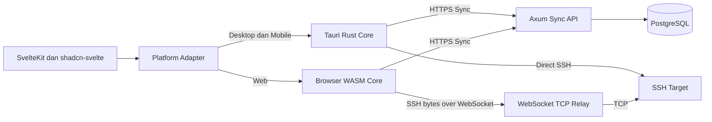

# Product Requirements Document Termust

**Status:** Draft untuk validasi dan perencanaan implementasi  
**Versi:** 1.2  
**Tanggal:** 14 Oktober 2026  
**Pemilik produk:** Termust Project  
**Target:** Open-source, self-hostable, web, desktop, Android, dan iOS

## 1. Ringkasan Eksekutif

Termust adalah klien SSH open-source, local-first, dan cross-platform untuk mengelola koneksi server dari desktop, perangkat seluler, dan browser. Termust menggabungkan terminal interaktif, pengelolaan host, SFTP, snippets, sinkronisasi lintas perangkat dengan end-to-end encryption, serta akses tim yang dapat diaudit.

Pengguna memilih salah satu dari tiga mode: local-only tanpa account, Termust Cloud sebagai SaaS resmi yang dioperasikan pemilik proyek, atau Termust Server yang di-self-host. Termust Cloud dan self-hosted memakai server binary, API, sync protocol, crypto format, serta client yang sama. Desktop dan mobile tetap melakukan koneksi SSH langsung dari device; server hanya menyimpan ciphertext serta metadata yang diperlukan untuk account dan sinkronisasi. Koneksi SSH melalui server hanya diperlukan pada browser atau ketika organisasi secara eksplisit memilih brokered access.

Termust menggunakan SvelteKit dan shadcn-svelte untuk antarmuka, Tauri v2 dan Rust untuk aplikasi desktop serta mobile, xterm.js untuk terminal, `russh` untuk protokol SSH, dan Axum serta PostgreSQL untuk layanan sinkronisasi. UI dibagikan antaraplikasi, sedangkan kemampuan yang bergantung pada sistem operasi diakses melalui adapter platform.

Produk harus tetap dapat digunakan tanpa akun dan tanpa server Termust. Sinkronisasi, akses web, dan kolaborasi tim merupakan kemampuan tambahan. Server sinkronisasi tidak boleh menerima plaintext password, private key, passphrase, isi snippet, atau detail sensitif host. Browser memakai relay WebSocket untuk membawa aliran SSH terenkripsi; backend tidak mengakhiri koneksi SSH pada mode zero-knowledge.

Untuk akses tim, Termust membedakan dua model keamanan:

1. **Direct secret access:** perangkat anggota menerima dan mendekripsi kredensial tim. Pengguna yang mengontrol perangkat secara teknis dapat mengekstrak kredensial tersebut.
2. **Brokered access:** anggota memperoleh sertifikat SSH berumur pendek atau terhubung melalui gateway. Kredensial bersama tidak pernah dikirim ke perangkat anggota.

Termust tidak boleh menjanjikan bahwa kredensial yang sudah didekripsi pada perangkat pengguna tetap tersembunyi dari pengguna tersebut.

## 2. Latar Belakang dan Masalah

Administrator sistem, developer, DevOps engineer, dan tim infrastruktur sering bekerja dari beberapa perangkat. Konfigurasi SSH biasanya tersebar di file lokal, password manager, aplikasi terminal, dan dokumentasi internal. Solusi komersial mempermudah sinkronisasi, tetapi dapat membatasi self-hosting, audit independen, interoperabilitas, atau kendali atas data.

Termust menyelesaikan kebutuhan berikut:

- Satu katalog host yang konsisten di desktop, mobile, dan web.
- Terminal SSH yang nyaman tanpa mengorbankan verifikasi host key.
- Sinkronisasi terenkripsi yang tidak mengharuskan server mempercayai isi data pengguna.
- Mode local-only yang tetap lengkap untuk pengguna individual.
- Kolaborasi tim dengan izin yang jelas dan metode akses tanpa membagikan private key bersama.
- Pilihan layanan cloud resmi atau deployment self-hosted.

## 3. Visi dan Prinsip Produk

### 3.1 Visi

Menjadi klien akses server open-source yang aman, nyaman, dan dapat dimiliki sendiri, tanpa mengunci pengguna pada satu penyedia cloud.

### 3.2 Prinsip

- **Local-first:** fungsi SSH dasar tidak bergantung pada akun atau koneksi ke layanan Termust.
- **Zero-knowledge by default:** payload vault dienkripsi pada client sebelum disinkronkan.
- **Security claims must be enforceable:** UI tidak boleh menyebut suatu secret “tersembunyi” jika client sebenarnya menerima kunci untuk mendekripsinya.
- **Direct connection by default:** desktop dan mobile terhubung langsung ke target SSH.
- **Explicit trust boundaries:** mode browser, gateway, dan team access harus menampilkan pihak yang menangani koneksi.
- **Deployment choice:** pengguna bebas memilih local-only, SaaS resmi, atau self-hosted tanpa client khusus.
- **Open protocol:** format export, skema vault, server discovery, dan sync protocol didokumentasikan.
- **Progressive complexity:** fitur personal dibuat stabil sebelum fitur organisasi dan enterprise.
- **Accessible and keyboard-first:** seluruh fungsi utama desktop dan web dapat digunakan tanpa mouse.

## 4. Sasaran dan Non-Sasaran

### 4.1 Sasaran

- Menyediakan SSH terminal untuk Windows, macOS, Linux, Android, iOS, dan browser.
- Menyediakan pengelolaan host, grup, credential, snippets, dan known-host fingerprints.
- Mendukung penggunaan local-only dan penggunaan dengan sinkronisasi.
- Menyediakan Termust Cloud sebagai layanan SaaS resmi.
- Menyediakan server self-hosted dengan feature protocol yang kompatibel dengan SaaS.
- Menyediakan E2EE per vault dengan pemulihan akun yang eksplisit.
- Menyediakan offline editing dan sinkronisasi yang tahan konflik.
- Menyediakan SFTP visual dan forwarding sesuai kemampuan platform.
- Menyediakan team vault, RBAC, audit event, dan brokered access.
- Menyediakan deployment self-hosted yang terdokumentasi.

### 4.2 Non-Sasaran Awal

- Menjadi shell, sistem operasi, IDE penuh, atau pengganti `tmux`.
- Menjamin sesi mobile tetap hidup tanpa batas ketika aplikasi berada di background.
- Menyembunyikan secret dari pengguna yang diberi kemampuan decrypt pada perangkatnya.
- Menyediakan session recording pada rilis personal pertama.
- Mendukung RDP, VNC, Kubernetes exec, database client, atau serial terminal pada MVP.
- Menyediakan billing, SCIM, atau compliance certification pada rilis awal.

## 5. Pengguna Sasaran

### 5.1 Individual Developer

Mengelola beberapa VPS dan development server dari laptop serta ponsel. Membutuhkan host list, snippets, private key, dan sync yang mudah.

### 5.2 DevOps dan SRE

Mengakses banyak environment, memakai jump host, forwarding, SFTP, dan verifikasi host key. Membutuhkan pencarian cepat, reliability, dan audit event.

### 5.3 Team Administrator

Mengundang anggota, mengatur group access, menghapus akses, merotasi kunci, dan memilih apakah anggota mendapat direct secret access atau brokered access.

### 5.4 Self-Hosting Administrator

Menjalankan Termust Sync Server di infrastrukturnya sendiri, mengatur OIDC, backup PostgreSQL, gateway policy, dan observability.

## 6. Terminologi

| Istilah | Definisi |
| --- | --- |
| Account | Identitas pengguna pada sync server. Tidak diperlukan untuk local-only mode. |
| Device | Instalasi Termust yang memiliki pasangan kunci perangkat sendiri. |
| Vault | Batas kriptografi dan sinkronisasi untuk sekumpulan object. |
| Personal Vault | Vault privat milik satu pengguna. |
| Team Vault | Vault yang kuncinya dibagikan kepada device anggota yang berwenang. |
| Vault Key | Kunci simetris acak untuk mengenkripsi object di dalam vault. |
| Key Envelope | Vault Key yang dibungkus untuk master password, recovery key, atau public key device tertentu. |
| Host | Konfigurasi target SSH, termasuk alamat, port, dan kebijakan host key. |
| Credential | Username, password, private key, certificate, atau referensi SSH agent. |
| Brokered Access | Akses tanpa mengirim shared credential ke client, melalui SSH certificate atau gateway. |
| Sync Object | Record terenkripsi yang disinkronkan secara independen. |
| Termust Cloud | Deployment SaaS resmi yang dikelola operator proyek Termust. |
| Self-Hosted Instance | Deployment Termust Server pada infrastruktur pengguna atau organisasi. |
| Instance ID | Identifier unik server yang mengisolasi account, token, dan konfigurasi antar-deployment. |

## 7. Platform dan Scope Rilis

| Capability | Desktop | Android dan iOS | Web |
| --- | --- | --- | --- |
| Host management | Penuh | Penuh | Penuh saat vault terbuka |
| Direct SSH | Ya | Ya | Tidak, memakai relay |
| Zero-knowledge web SSH | Tidak relevan | Tidak relevan | SSH di browser melalui WASM dan byte relay |
| SFTP | Penuh | Bertahap | Setelah terminal web stabil |
| Local forwarding | Penuh | Terbatas oleh OS | Tidak pada rilis awal |
| Remote forwarding | Penuh | Terbatas | Tidak pada rilis awal |
| Dynamic SOCKS5 | Penuh | Tidak pada rilis awal | Tidak |
| Offline vault | Penuh | Penuh | Cache terenkripsi terbatas dan opt-in |
| Background session | Ya | Best effort | Bergantung tab browser |

### 7.1 Urutan Produk

1. Technical spike lintas platform.
2. Local-first desktop MVP.
3. Personal E2EE sync.
4. Android dan iOS beta.
5. Web terminal zero-knowledge.
6. Team vault dan brokered access.
7. Enterprise controls.

### 7.2 Mode Penggunaan

| Mode | Account | Lokasi data | SSH desktop dan mobile | SSH web |
| --- | --- | --- | --- | --- |
| Local-only | Tidak | Device pengguna | Langsung dari device | Tidak tersedia tanpa server |
| Termust Cloud | Ya | SaaS resmi, payload E2EE | Langsung dari device | Melalui relay Termust Cloud |
| Self-hosted | Ya pada instance tersebut | Infrastruktur operator self-hosted, payload E2EE | Langsung dari device | Melalui relay instance bila diaktifkan |

Account, device, organization, dan vault selalu memiliki scope satu server instance. Email yang sama pada Termust Cloud dan self-hosted dianggap dua account berbeda. Token dari satu instance tidak boleh pernah dikirim ke instance lain.

## 8. User Journey Utama

### 8.1 Pengguna Local-Only

1. Pengguna membuka Termust tanpa membuat akun.
2. Pengguna membuat local vault dan menentukan unlock method.
3. Pengguna menambahkan host serta credential.
4. Termust meminta konfirmasi fingerprint pada koneksi pertama.
5. Pengguna membuka terminal, menjalankan snippet, atau menggunakan SFTP.
6. Pengguna dapat mengekspor backup terenkripsi.

### 8.2 Memilih Layanan Sinkronisasi

1. Pengguna memilih Termust Cloud atau memasukkan HTTPS URL Termust Server miliknya.
2. Client membaca `/.well-known/termust`, menampilkan nama instance, operator, protocol version, fitur aktif, dan kebijakan registrasi.
3. Pengguna mengonfirmasi instance sebelum credential account dikirim.
4. Client menyimpan profile instance berdasarkan `instance_id`, bukan hanya hostname.
5. Pengguna membuat account baru atau login pada instance tersebut.

### 8.3 Mengaktifkan Sinkronisasi

1. Pengguna membuat master password atau recovery key vault.
2. Local vault dimigrasikan menjadi personal synced vault setelah konfirmasi.
3. Client mengunggah ciphertext dan key envelopes, bukan plaintext.
4. Device baru ditambahkan menggunakan master password, recovery key, atau persetujuan device yang sudah aktif.
5. Pengguna dapat kembali ke local-only setelah mengekspor atau membuat salinan lokal yang aman; penghapusan data server adalah tindakan terpisah.

### 8.4 Akses dari Browser

1. Pengguna login dan membuka vault secara lokal di browser.
2. Browser mengunduh encrypted host record dan mendekripsinya.
3. Browser menjalankan SSH client berbasis WASM.
4. Authenticated WebSocket relay meneruskan byte SSH ke target TCP.
5. Browser memverifikasi host key dan merender terminal dengan xterm.js.

### 8.5 Mengundang Anggota Tim

1. Owner atau Admin mengundang account ke organization.
2. Anggota menyetujui invitation dari device tertentu.
3. Server mencatat membership dan role yang tidak dienkripsi agar otorisasi dapat diterapkan.
4. Client admin membuat key envelope Team Vault Key untuk device anggota jika direct secret access diizinkan.
5. Untuk connect-only access, anggota menerima short-lived SSH certificate atau akses melalui gateway, bukan Team Vault Key yang dapat membuka shared credential.

### 8.6 Mencabut Anggota

1. Admin menghapus membership atau group grant.
2. Server menolak sync dan issuance baru untuk device tersebut.
3. Team Vault Key memasuki epoch baru dan object aktif dienkripsi ulang bila anggota sebelumnya memiliki direct secret access.
4. Shared server credential yang pernah tersedia bagi anggota harus dirotasi untuk pencabutan yang benar-benar efektif.

## 9. Kebutuhan Fungsional

### 9.1 Account dan Device

- **AUTH-001:** Aplikasi dapat digunakan tanpa account dalam local-only mode.
- **AUTH-002:** Hosted dan self-hosted server mendukung email login; passkey dan OIDC diprioritaskan, password account menjadi fallback.
- **AUTH-003:** Password account dan master password vault diperlakukan sebagai dua domain keamanan berbeda.
- **AUTH-004:** Setiap instalasi memiliki `device_id`, Ed25519 signing key, dan X25519 key-agreement key.
- **AUTH-005:** Device dapat diberi nama, dilihat last-seen-nya, dan dicabut dari device management.
- **AUTH-006:** Session token dapat dicabut per device dan memiliki masa berlaku terbatas.
- **AUTH-007:** Penambahan device baru menghasilkan security notification pada device aktif.

### 9.2 Vault dan Secret Management

- **VAULT-001:** Pengguna dapat membuat, mengunci, membuka, mengganti nama, mengekspor, dan menghapus vault.
- **VAULT-002:** Semua field sensitif dienkripsi sebelum masuk SQLite, IndexedDB, log, crash report, atau sync API.
- **VAULT-003:** Vault otomatis terkunci setelah timeout yang dapat dikonfigurasi.
- **VAULT-004:** Desktop dan mobile dapat menggunakan OS keychain atau biometric gate untuk membuka key envelope yang sudah tersimpan.
- **VAULT-005:** Recovery key ditampilkan sekali dan dapat diekspor sebagai recovery kit.
- **VAULT-006:** Hilangnya master password dan recovery key harus dijelaskan sebagai kehilangan akses permanen pada zero-knowledge mode.
- **VAULT-007:** Clipboard secret dibersihkan setelah interval yang dapat dikonfigurasi bila platform mendukungnya.
- **VAULT-008:** Secret tidak pernah ditampilkan default; reveal dan copy menghasilkan local security event.

### 9.3 Host, Group, dan Credential

- **HOST-001:** Pengguna dapat membuat host dengan label, hostname atau IP, port, username, tags, group, icon, color, dan catatan.
- **HOST-002:** Host mendukung credential password, private key, encrypted private key, SSH agent, dan OpenSSH certificate.
- **HOST-003:** Satu credential dapat direferensikan beberapa host tanpa menduplikasi secret.
- **HOST-004:** Host mendukung proxy jump dan rantai jump host dengan deteksi siklus.
- **HOST-005:** Import mendukung subset yang terdokumentasi dari OpenSSH config.
- **HOST-006:** Export tersedia dalam format Termust terenkripsi dan format non-secret yang interoperabel.
- **HOST-007:** Pencarian dapat menemukan host berdasarkan label, address, tag, group, dan username setelah vault dibuka.
- **HOST-008:** Delete memakai tombstone agar penghapusan tersinkron dan tidak muncul kembali dari device offline.

### 9.4 Known Hosts dan Trust

- **TRUST-001:** Koneksi pertama menampilkan algoritma dan fingerprint host key.
- **TRUST-002:** Pengguna harus menyetujui host key baru kecuali policy organisasi menentukan fingerprint sebelumnya.
- **TRUST-003:** Host key mismatch memblokir koneksi dan tidak dapat dilewati tanpa tindakan eksplisit.
- **TRUST-004:** Known-host record disimpan terenkripsi dan dapat disinkronkan.
- **TRUST-005:** Team policy dapat mengunci expected fingerprint agar member tidak dapat menggantinya.

### 9.5 Terminal dan SSH Session

- **SSH-001:** Terminal mendukung PTY interaktif, resize, Unicode, true color, copy-paste, search, dan reconnect workflow.
- **SSH-002:** Pengguna dapat membuka banyak tab dan split pane di desktop serta web.
- **SSH-003:** Session mendukung password, public key, certificate, agent, dan keyboard-interactive authentication.
- **SSH-004:** Client mengirim keepalive yang dapat dikonfigurasi dan membedakan network failure dari authentication failure.
- **SSH-005:** Terminal tidak menyimpan scrollback persisten kecuali pengguna mengaktifkannya.
- **SSH-006:** Session restore menyimpan metadata tab, bukan secret atau isi terminal secara default.
- **SSH-007:** Mobile menyediakan accessory row untuk Esc, Ctrl, Alt, Tab, arrow, pipe, slash, dash, dan tombol yang dapat dikustomisasi.
- **SSH-008:** Saat mobile masuk background, aplikasi menjelaskan bahwa OS dapat menangguhkan koneksi dan menawarkan reconnect atau attach ke `tmux`.
- **SSH-009:** Legacy SSH algorithms dinonaktifkan secara default dan hanya dapat diaktifkan per host dengan peringatan.

### 9.6 SFTP

- **SFTP-001:** Desktop menyediakan dual-pane local dan remote file browser.
- **SFTP-002:** Pengguna dapat upload, download, rename, move, delete, create directory, dan mengubah permission dasar.
- **SFTP-003:** Transfer besar menampilkan progress, throughput, cancel, retry, dan error detail.
- **SFTP-004:** Resume hanya ditawarkan bila implementasi dapat memastikan konsistensi file.
- **SFTP-005:** Mobile menyediakan file picker native dan download destination yang sesuai sandbox OS.
- **SFTP-006:** Web SFTP dirilis setelah SSH-over-WASM dan memory behavior tervalidasi.

### 9.7 Port Forwarding

- **FWD-001:** Desktop mendukung local, remote, dan dynamic SOCKS5 forwarding.
- **FWD-002:** Forward dapat disimpan sebagai konfigurasi host atau dibuat sementara.
- **FWD-003:** UI menampilkan bind address, port, target, status, dan error bind dengan jelas.
- **FWD-004:** Bind ke interface non-loopback memerlukan peringatan keamanan.
- **FWD-005:** Dukungan mobile bersifat per-platform dan tidak menjadi acceptance criterion rilis mobile pertama.

### 9.8 Snippets dan Automation

- **SNIP-001:** Snippet memiliki nama, isi, tags, variables, dan scope personal atau team.
- **SNIP-002:** Variable dapat diminta saat eksekusi dan dapat ditandai secret.
- **SNIP-003:** Auto-run snippet dinonaktifkan default dan memerlukan konfirmasi saat pertama kali ditautkan ke host.
- **SNIP-004:** Snippet berisiko tinggi menampilkan preview sebelum dikirim.
- **SNIP-005:** Termust tidak mengklaim shell parsing universal; pengiriman snippet diperlakukan sebagai input terminal.

### 9.9 Offline dan Sinkronisasi

- **SYNC-001:** Semua create, update, dan delete dapat dilakukan offline pada desktop dan mobile.
- **SYNC-002:** Mutation queue menyimpan `mutation_id`, `object_id`, `base_version`, encrypted payload, dan waktu lokal untuk display saja.
- **SYNC-003:** Server memberikan monotonic sequence per vault dan authoritative object version.
- **SYNC-004:** Retry mutation bersifat idempotent.
- **SYNC-005:** WebSocket hanya memberi notifikasi perubahan; client mengambil delta melalui authenticated sync API.
- **SYNC-006:** Bila `base_version` sudah usang, server mengembalikan conflict dan tidak diam-diam menimpa object.
- **SYNC-007:** Conflict pada record yang sama menghasilkan pilihan keep local, keep remote, atau duplicate and merge.
- **SYNC-008:** Delete direpresentasikan sebagai tombstone dengan retention period.
- **SYNC-009:** Client dapat melakukan full reconciliation bila cursor invalid atau retention terlewati.
- **SYNC-010:** Status UI membedakan synced, pending, offline, conflict, locked, dan error.

### 9.10 Web Client dan Relay

- **WEB-001:** Web client tidak membutuhkan Tauri API dan memakai platform adapter berbasis browser.
- **WEB-002:** Crypto vault berjalan pada client, idealnya melalui shared Rust core yang dikompilasi ke WASM.
- **WEB-003:** Default web SSH menjalankan protokol SSH di browser dan memakai gateway sebagai authenticated byte relay.
- **WEB-004:** Gateway tidak menerima password, private key, decrypted Team Vault Key, atau plaintext terminal pada zero-knowledge mode.
- **WEB-005:** Gateway membatasi destination, DNS resolution, port, durasi, bandwidth, dan concurrency untuk mencegah SSRF serta penyalahgunaan.
- **WEB-006:** Browser memverifikasi host key sebelum autentikasi.
- **WEB-007:** Mode server-terminated SSH, bila kelak disediakan, harus opt-in, diberi label jelas, dan tidak boleh disebut zero-knowledge.
- **WEB-008:** Cache offline browser dinonaktifkan default untuk secret dan harus dienkripsi bila pengguna mengaktifkannya.

### 9.11 Organization, Team, dan RBAC

- **TEAM-001:** Pengguna dapat membuat organization dan satu atau lebih team vault.
- **TEAM-002:** Owner dan Admin dapat mengundang, mencabut, dan mengubah role anggota.
- **TEAM-003:** Izin dapat dibatasi per group.
- **TEAM-004:** Role default terdiri dari Owner, Admin, Editor, Operator, dan Auditor.
- **TEAM-005:** Permission atomik meliputi `manage_org`, `manage_members`, `manage_vault`, `manage_hosts`, `manage_credentials`, `use_credentials`, `brokered_connect`, `manage_snippets`, dan `view_audit`.
- **TEAM-006:** Operator connect-only tidak menerima key envelope yang dapat membuka shared credential.
- **TEAM-007:** Direct secret access selalu ditandai sebagai kemampuan untuk mendekripsi dan secara teknis mengekstrak secret.
- **TEAM-008:** Perubahan role diterapkan server-side untuk sync authorization dan issuance authorization.
- **TEAM-009:** Key rotation menggunakan epoch; object baru menggunakan epoch aktif.
- **TEAM-010:** Revocation menjelaskan bahwa data yang sebelumnya sudah didekripsi atau disalin tidak dapat ditarik kembali.

### 9.12 Audit

- **AUDIT-001:** Server mencatat login, device enrollment, membership change, policy change, sync write, certificate issuance, dan gateway session lifecycle.
- **AUDIT-002:** Direct SSH hanya menghasilkan client-reported event dan tidak boleh diklaim sebagai bukti koneksi yang tidak dapat dimanipulasi.
- **AUDIT-003:** Gateway atau certificate authority event merupakan server-observed event.
- **AUDIT-004:** Audit log tidak menyimpan terminal content, command, password, private key, atau decrypted payload secara default.
- **AUDIT-005:** Retention dan export audit dapat dikonfigurasi oleh administrator.

### 9.13 Backup, Import, dan Recovery

- **BACKUP-001:** Pengguna dapat membuat export vault terenkripsi dengan versi format eksplisit.
- **BACKUP-002:** Restore tidak menimpa vault aktif tanpa preview dan konfirmasi.
- **BACKUP-003:** Self-hosted documentation mencakup backup PostgreSQL dan object storage bila digunakan.
- **BACKUP-004:** Server backup tanpa recovery key pengguna tidak dapat membuka payload E2EE.
- **BACKUP-005:** Recovery drill menjadi bagian acceptance test sebelum rilis stable.

### 9.14 Server Instance dan Pilihan Deployment

- **INSTANCE-001:** Onboarding menawarkan tiga pilihan yang setara: Continue Local-Only, Sign In to Termust Cloud, dan Connect to Self-Hosted Server.
- **INSTANCE-002:** Custom server ditambahkan menggunakan HTTPS base URL dan diverifikasi melalui `/.well-known/termust`.
- **INSTANCE-003:** Discovery response memuat `instance_id`, nama, operator, protocol version, minimum client version, feature flags, registration policy, web URL, dan relay availability.
- **INSTANCE-004:** Client memisahkan token, account, cache, device registration, dan sync state per `instance_id`.
- **INSTANCE-005:** Self-hosted instance dapat menetapkan registration policy `open`, `invite_only`, atau `disabled`.
- **INSTANCE-006:** Self-hosted instance menyediakan bootstrap flow untuk membuat administrator pertama, lalu menonaktifkan bootstrap token.
- **INSTANCE-007:** Self-hosted deployment tidak mengirim telemetry, license check, atau data operasional ke Termust Cloud kecuali operator mengaktifkannya secara eksplisit.
- **INSTANCE-008:** Termust Cloud dan self-hosted menjalankan API serta sync protocol yang sama; fitur komersial tidak boleh mengubah format vault.
- **INSTANCE-009:** Migrasi antarinstance pada versi awal dilakukan melalui export dan import terenkripsi. Server-to-server migration bukan requirement awal.
- **INSTANCE-010:** Mengganti sync instance tidak otomatis menghapus data dari instance lama dan memerlukan konfirmasi tujuan serta status upload.
- **INSTANCE-011:** Desktop dan mobile selalu melakukan direct SSH kecuali host atau organization policy memilih brokered access.
- **INSTANCE-012:** Self-hosted operator dapat menonaktifkan web client, relay, team features, registration, email, atau certificate authority secara independen.

## 10. Model Izin

| Capability | Owner | Admin | Editor | Operator | Auditor |
| --- | ---: | ---: | ---: | ---: | ---: |
| Menghapus organization | Ya | Tidak | Tidak | Tidak | Tidak |
| Mengelola anggota | Ya | Ya | Tidak | Tidak | Tidak |
| Mengatur policy dan group grant | Ya | Ya | Tidak | Tidak | Tidak |
| Membuat dan mengubah host | Ya | Ya | Ya | Tidak | Tidak |
| Mengubah shared credential | Ya | Opsional | Opsional | Tidak | Tidak |
| Direct secret access | Sesuai policy | Sesuai policy | Sesuai policy | Tidak default | Tidak |
| Brokered connect | Ya | Ya | Ya | Untuk group yang ditugaskan | Tidak |
| Mengelola snippets | Ya | Ya | Ya | Gunakan saja | Tidak |
| Melihat audit | Ya | Ya | Opsional | Event sendiri | Ya |

Role adalah preset. Server menyimpan permission atomik dan group grant sebagai sumber otorisasi, sehingga preset dapat berkembang tanpa migrasi semantik besar.

## 11. UX dan Design System

### 11.1 Teknologi UI

- Svelte 5 dan SvelteKit.
- Tailwind CSS 4.
- shadcn-svelte gaya `new-york` sebagai fondasi komponen yang dimiliki langsung oleh repository.
- Bits UI primitives untuk behavior aksesibel.
- Lucide untuk icon dengan label atau tooltip yang bermakna.
- xterm.js untuk terminal.
- Paneforge atau primitive setara untuk split pane.

Penggunaan shadcn-svelte tidak berarti seluruh UI harus menyerupai dashboard generik. Komponen disalin ke repository, diberi token Termust, diuji, dan diperlakukan sebagai internal design system.

### 11.2 Token Visual

- Dark theme menjadi default terminal experience; light theme tetap didukung.
- Warna menggunakan semantic tokens seperti `background`, `surface`, `muted`, `danger`, `warning`, `success`, dan `terminal-*`.
- Status tidak boleh disampaikan hanya dengan warna.
- Radius, spacing, dan typography konsisten melalui CSS variables.
- Font terminal terpisah dari font UI dan dapat dikonfigurasi.

### 11.3 Information Architecture Desktop dan Web

```text
App Shell
├── Sidebar
│   ├── Quick Connect
│   ├── Hosts
│   ├── Groups
│   ├── Snippets
│   ├── Transfers
│   └── Team
├── Workspace
│   ├── Terminal Tabs
│   ├── Split Panes
│   └── SFTP
└── Utility
    ├── Sync Status
    ├── Vault Lock
    ├── Command Palette
    └── Settings
```

Komponen utama shadcn-svelte yang digunakan meliputi Sidebar, Command, Dialog, Drawer, Sheet, Dropdown Menu, Context Menu, Tabs, Tooltip, Form, Input, Select, Switch, Alert Dialog, Table, Scroll Area, Resizable, Toast, Badge, Skeleton, dan Progress.

### 11.4 Mobile Navigation

- Bottom navigation: Hosts, Sessions, Snippets, dan Settings.
- Host detail memakai sheet atau full screen, bukan modal sempit.
- Terminal memakai seluruh viewport dengan toolbar yang dapat disembunyikan.
- Long-press membuka context action; semua action tetap tersedia melalui tombol yang terlihat.
- Safe area, orientation change, dan virtual keyboard resize harus diuji di iOS serta Android.

### 11.5 Accessibility

- Target WCAG 2.2 AA untuk UI non-terminal.
- Keyboard navigation lengkap pada desktop dan web.
- Focus indicator selalu terlihat.
- Dialog mengembalikan focus ke pemicu.
- Screen reader mendapat nama session, host, status, dan error yang jelas.
- Reduce motion dihormati.
- Terminal memiliki mode screen-reader dan announcement yang dapat dikendalikan.

## 12. Arsitektur Sistem



### 12.1 Monorepo

```text
termust/
├── apps/
│   ├── client/                 # SvelteKit UI
│   └── server/                 # Axum API, sync, auth, relay
├── crates/
│   ├── termust-domain/         # Shared domain types
│   ├── termust-crypto/         # Vault format dan key management
│   ├── termust-sync/           # Sync state machine dan protocol
│   ├── termust-ssh/            # russh integration
│   ├── termust-storage/        # SQLite dan repository contracts
│   └── termust-wasm/           # Browser exports
├── packages/
│   ├── ui/                     # shadcn-svelte-derived components
│   ├── platform/               # TypeScript platform contracts
│   └── protocol/               # Generated API types bila diperlukan
├── src-tauri/
└── deploy/
    ├── docker/
    └── helm/
```

### 12.2 Platform Adapter

UI berinteraksi dengan interface yang stabil, bukan langsung dengan Tauri commands:

```ts
interface TermustPlatform {
  vault: VaultProvider;
  ssh: SshProvider;
  storage: StorageProvider;
  sync: SyncProvider;
  biometrics: BiometricProvider;
  files: FileTransferProvider;
}
```

Desktop dan mobile memakai Tauri IPC. Web memakai WASM, WebCrypto bila kompatibel dengan format protokol, IndexedDB, HTTPS, dan WebSocket. Permission Tauri mengikuti least privilege dan command hanya tersedia bagi window yang memerlukannya.

### 12.3 SvelteKit Build

- UI client dibangun sebagai static application untuk Tauri.
- Route yang membutuhkan server rendering tidak digunakan di bundle Tauri.
- Web deployment dapat memakai static hosting ditambah Axum API, atau SvelteKit server terpisah bila kelak diperlukan.
- Platform-specific code diisolasi melalui dynamic import agar Tauri API tidak masuk jalur browser.

### 12.4 Topologi Deployment

Termust memakai satu codebase server dengan dua profil operasi:

```text
Termust Cloud
├── Multi-tenant Axum API
├── Managed PostgreSQL atau Supabase Postgres
├── Hosted Web Client
├── Regional Relay
└── SaaS-only operations seperti limits, support, dan billing

Self-Hosted Termust
├── Axum API yang sama
├── PostgreSQL lokal atau managed PostgreSQL
├── Optional Web Client
├── Optional Relay
└── Operator-defined registration, email, OIDC, dan retention
```

Perbedaan SaaS dan self-hosted harus dikendalikan melalui konfigurasi dan feature flags server, bukan fork protocol. Client tidak mengasumsikan hostname Termust Cloud dan selalu bekerja terhadap instance profile.

### 12.5 Server Discovery

Endpoint publik `/.well-known/termust` tidak memerlukan autentikasi dan hanya mengembalikan metadata non-sensitif. Client memverifikasi HTTPS, menyimpan `instance_id`, dan memperingatkan pengguna jika hostname yang sama tiba-tiba menyatakan instance ID berbeda. Pinning sertifikat tidak menjadi default karena akan menyulitkan rotasi TLS, tetapi organisasi dapat mendistribusikan trusted instance configuration melalui managed policy.

## 13. Arsitektur Keamanan

### 13.1 Trust Boundary

Termust mempercayai client yang sedang terbuka untuk menangani plaintext selama diperlukan. Sync server, database operator, backup operator, dan network observer tidak dipercaya untuk membaca payload vault. Perangkat yang sudah dikompromikan berada di luar jaminan E2EE.

Server tetap melihat metadata operasional berikut:

- Account identifier dan email.
- Device identifier, public key, dan last seen.
- Organization membership, role, group grant, dan vault membership.
- Object identifier, object type bila diperlukan untuk routing, ukuran ciphertext, versi, dan waktu perubahan.
- Destination hostname atau IP serta metadata koneksi ketika web relay digunakan.

Metadata leakage ini harus didokumentasikan pada privacy model.

### 13.2 Primitive Kriptografi

- Argon2id untuk derivasi master password dengan parameter yang tersimpan bersama envelope.
- XChaCha20-Poly1305 untuk authenticated encryption payload dan key envelope.
- X25519 atau HPKE untuk membungkus Vault Key ke device.
- Ed25519 untuk signature invitation, device assertion, atau operation yang memerlukan autentisitas client.
- HKDF-SHA-256 untuk derivasi subkey dengan domain separation.
- CSPRNG platform untuk seluruh key dan nonce.
- `zeroize` dan secret wrapper untuk mengurangi lifetime secret di memory.

Parameter dan format ciphertext memiliki `crypto_version` agar dapat dimigrasikan. Algoritma tidak boleh dirancang sendiri di luar konstruksi standar.

### 13.3 Hierarki Kunci Personal Vault

```text
Master Password
    └── Argon2id dan salt
        └── Password KEK
            └── membuka Personal Vault Key envelope

Recovery Key
    └── HKDF
        └── Recovery KEK
            └── membuka Personal Vault Key envelope

Device X25519 Public Key
    └── Device envelope
        └── membuka Personal Vault Key

Personal Vault Key
    └── HKDF per object dan version
        └── mengenkripsi Host, Credential, Snippet, Known Host
```

Master password tidak pernah dikirim ke server. Password autentikasi account tidak digunakan langsung sebagai encryption key.

### 13.4 Object Encryption

Setiap object memiliki payload mandiri. Additional authenticated data mencakup minimal:

- Protocol version.
- Vault ID.
- Object ID.
- Object type.
- Schema version.
- Key epoch.

Object menggunakan nonce acak baru pada setiap encryption. Client menolak ciphertext bila AEAD validation gagal.

### 13.5 Device Enrollment

Device baru dapat memperoleh Vault Key melalui:

1. Master password.
2. Recovery key.
3. Approval dari device aktif melalui QR atau short authentication string.

Approval device menggunakan authenticated ephemeral key agreement. QR tidak boleh memuat unencrypted Vault Key.

### 13.6 Team Vault

- Team Vault Key dibuat random oleh authorized client.
- Direct-access device menerima key envelope tersendiri.
- Connect-only device tidak menerima envelope yang membuka shared credential.
- Setiap rotasi menghasilkan `key_epoch` baru.
- Removal menghentikan akses server dan issuance baru segera.
- Re-encryption melindungi object baru dan object yang diperbarui, tetapi tidak menghapus salinan plaintext atau ciphertext lama yang sudah diperoleh mantan anggota.

### 13.7 Brokered Access

Urutan preferensi:

1. **Short-lived OpenSSH certificate:** device membuat SSH key sendiri; Termust CA menandatangani certificate dengan principal, target scope, dan masa berlaku terbatas.
2. **Gateway session:** gateway menyimpan atau mengambil credential dari server-side secret store dan mengakhiri SSH. Mode ini bukan zero-knowledge terhadap gateway, tetapi shared credential tidak dikirim ke member.
3. **Direct shared credential:** hanya untuk role dan policy yang secara eksplisit mengizinkan secret access.

Organization dapat memaksa seluruh koneksi production melalui certificate atau gateway.

### 13.8 Secret Storage Lokal

- Payload tetap terenkripsi di SQLite atau IndexedDB.
- Device private key dan local unlock material disimpan melalui OS Keychain, Android Keystore, iOS Keychain, atau Tauri Stronghold sesuai hasil threat review.
- Biometric hanya menjadi gate untuk membuka material yang sudah tersimpan.
- Log, panic message, tracing span, analytics, dan crash dump disanitasi.

### 13.9 Host Security

- Strict host key checking menjadi default.
- Fingerprint mismatch selalu memblokir.
- Agent forwarding dinonaktifkan default.
- Port forwarding non-loopback menampilkan warning.
- Clipboard paste multiline dapat menampilkan konfirmasi.
- URL dan OSC escape sequence dari terminal diperlakukan sebagai untrusted input.

## 14. Protokol Sinkronisasi

### 14.1 Model

Sinkronisasi bersifat operation-based pada client dan object-based pada server. Server tidak melakukan merge plaintext.

Setiap object server memiliki:

```text
object_id
vault_id
object_kind
encrypted_payload
nonce
crypto_version
key_epoch
object_version
vault_sequence
deleted_at
created_at
updated_at
```

### 14.2 Push

Client mengirim mutation dengan `mutation_id`, `object_id`, `base_version`, dan ciphertext baru. Server:

1. Memvalidasi account, device, vault membership, dan permission.
2. Mengabaikan retry dengan `mutation_id` yang sudah berhasil diproses.
3. Membandingkan `base_version` dengan versi aktif.
4. Menyimpan mutation dan menaikkan `object_version` serta `vault_sequence` dalam satu transaksi.
5. Mengembalikan conflict bila base version tidak cocok.

### 14.3 Pull

Client menyimpan cursor sequence. Request pull mengembalikan seluruh perubahan setelah cursor, termasuk tombstone. Jika cursor terlalu lama, server meminta full reconciliation.

### 14.4 Conflict

- Perubahan pada object berbeda tidak berkonflik.
- Perubahan bersamaan pada object yang sama tidak diselesaikan memakai jam device.
- Untuk field non-secret tertentu, client dapat menawarkan visual merge setelah kedua payload didekripsi.
- Credential secret tidak di-merge otomatis.
- Delete versus update memerlukan keputusan pengguna atau policy yang terdokumentasi.

### 14.5 Realtime

WebSocket mengirim `vault_changed(vault_id, latest_sequence)` tanpa payload sensitif. Client kemudian menjalankan pull. Kehilangan WebSocket tidak memengaruhi correctness karena polling atau reconnect tetap memakai cursor.

## 15. Data Model Server

### 15.1 Tabel Utama

| Tabel | Tujuan |
| --- | --- |
| `server_settings` | Instance identity, public feature policy, dan deployment mode. |
| `users` | Account identity dan status. |
| `auth_identities` | Passkey, OIDC subject, atau password account hash. |
| `devices` | Device public keys, name, status, last seen. |
| `sessions` | Refresh session yang dapat dicabut. |
| `organizations` | Organization dan owner. |
| `organization_members` | Role serta lifecycle membership. |
| `groups` | Access-control group; nama dapat dienkripsi bila routing tidak membutuhkannya. |
| `group_grants` | Permission user atau role pada group. |
| `vaults` | Personal atau team vault dan active key epoch. |
| `vault_members` | Otorisasi vault dan access mode. |
| `key_envelopes` | Wrapped Vault Key untuk password, recovery, atau device. |
| `sync_objects` | Ciphertext per object dan authoritative version. |
| `sync_mutations` | Idempotency receipt dan mutation metadata. |
| `vault_changes` | Change feed berdasarkan sequence. |
| `audit_events` | Append-oriented security dan administration events. |
| `invitations` | Invitation dengan expiration dan status. |
| `ssh_cert_issuances` | Certificate scope, principal, validity, dan revocation metadata. |
| `relay_sessions` | Web relay lifecycle dan policy result. |

### 15.2 Aturan Data

- Foreign key, unique constraint, dan transaction boundary harus eksplisit.
- Semua row multitenant memiliki organization atau vault scope yang dapat divalidasi.
- Query tidak hanya mengandalkan ID acak; authorization predicate selalu menyertai lookup.
- Database tidak menyimpan `master_key_hash` sebagai encryption material.
- Password account bila digunakan di-hash dengan Argon2id server-side dan salt unik.
- Soft-delete hanya digunakan ketika dibutuhkan untuk sync atau audit retention.

### 15.3 PostgreSQL Compatibility

Termust Server mendukung PostgreSQL standar sebagai kontrak database. Managed PostgreSQL seperti Supabase dapat digunakan dengan menyediakan connection string kepada Axum server. Desktop, mobile, dan browser tidak terhubung langsung ke PostgreSQL atau Supabase Data API.

Baseline kompatibilitas:

- PostgreSQL 16 dan 17 diuji pada CI.
- Schema aplikasi berada di namespace `termust`, bukan `public` atau `extensions`.
- Primary key menggunakan UUID yang dibuat aplikasi agar tidak bergantung pada extension provider.
- Fitur wajib dibatasi pada SQL dan tipe bawaan PostgreSQL.
- Extension provider-specific tidak boleh menjadi requirement core.
- Migration dikelola SQLx dan harus berhasil pada container PostgreSQL resmi serta Supabase project.
- `.sqlx` offline query metadata disimpan di repository agar production build tidak memerlukan database live.
- Runtime dan migration dapat memakai URL berbeda.

### 15.4 Supabase sebagai Database Provider

Supabase hanya dipakai sebagai managed PostgreSQL, bukan sebagai pengganti `termust-server`. Axum tetap menjadi satu-satunya application data plane dan menjalankan autentikasi, otorisasi, E2EE envelope handling, sync transaction, rate limiting, realtime notification, file metadata, serta audit. Authentication, storage, dan realtime merupakan komponen milik Termust dan tidak bergantung pada layanan aplikasi Supabase.

Ketentuan integrasi:

- `DATABASE_URL` dipakai oleh runtime Axum.
- `DATABASE_MIGRATION_URL` memakai direct connection untuk migration, `sqlx migrate`, backup, dan restore.
- Persistent Axum deployment memakai direct connection bila network mendukungnya, atau Supabase session pooler bila memerlukan IPv4.
- Transaction pooler hanya boleh dipakai setelah prepared statements dinonaktifkan, statement cache SQLx diatur kompatibel, dan fitur session-level seperti `LISTEN/NOTIFY`, temporary table lintas transaksi, serta advisory lock tidak digunakan.
- TLS database diwajibkan pada koneksi remote.
- Connection pool Axum disesuaikan dengan batas koneksi plan Supabase dan tidak memakai default tanpa review.
- Schema `termust` tidak diekspos ke role `anon` atau `authenticated` melalui Supabase Data API.
- Supabase service-role key tidak pernah didistribusikan ke client.
- Supabase Auth, Realtime, Storage, Edge Functions, dan Vault tidak digunakan oleh Termust. Integrasi terhadap layanan tersebut memerlukan keputusan arsitektur baru dan tidak termasuk scope saat ini.
- Backup, point-in-time recovery, region, dan retention tetap menjadi tanggung jawab operator sesuai layanan Supabase yang dipilih.

Dengan batas ini, deployment dapat berpindah antara Supabase, PostgreSQL resmi, atau provider managed PostgreSQL lain tanpa mengubah client dan format data.

## 16. API dan Protocol Surface

### 16.1 API Groups

```text
/.well-known/termust
/v1/instance
/v1/auth/*
/v1/devices/*
/v1/vaults/*
/v1/vaults/{id}/envelopes
/v1/sync/push
/v1/sync/pull
/v1/organizations/*
/v1/groups/*
/v1/invitations/*
/v1/audit/*
/v1/ssh-certificates/issue
/v1/relay/token
/v1/relay/ws
```

### 16.2 Ketentuan API

- HTTPS wajib kecuali loopback development.
- Access token berumur pendek; refresh session terikat device dan dapat dicabut.
- Request mutation memiliki idempotency key.
- Error memakai stable machine-readable code dan human-safe message.
- Payload limit, rate limit, timeout, dan pagination diterapkan.
- API version dan crypto version dipisahkan.
- OpenAPI diterbitkan untuk API non-WebSocket.
- Semua response autentikasi menyertakan atau terikat ke `instance_id` agar client dapat mendeteksi cross-instance token mix-up.

### 16.3 Relay Token

Relay token berumur sangat pendek dan terikat pada account, device, destination policy, maksimum durasi, serta nonce. Gateway melakukan DNS resolution secara aman, memeriksa ulang resolved IP terhadap policy, dan mencegah akses metadata service atau private range kecuali administrator mengizinkannya.

## 17. Kebutuhan Nonfungsional

### 17.1 Performa

- Cold start desktop target p50 di bawah 2 detik pada hardware referensi yang ditentukan tim.
- Input terminal tidak terasa tertunda pada koneksi dengan network latency normal.
- UI tetap responsif saat output terminal tinggi dan saat sync berjalan.
- Daftar 10.000 host tetap dapat dicari dan di-scroll tanpa blocking main thread yang terlihat.
- Sync menggunakan delta, bukan mengunduh ulang seluruh vault pada setiap perubahan.

### 17.2 Reliability

- Mutation tidak hilang saat aplikasi berhenti setelah local commit tetapi sebelum network acknowledgement.
- Retry tidak membuat duplicate object.
- Database migration dapat dijalankan maju dan memiliki prosedur rollback deployment.
- Gateway menghentikan resource ketika WebSocket terputus.
- Client membedakan transient error, permanent error, auth expiry, dan conflict.

### 17.3 Compatibility

- Desktop: dua major OS version yang masih didukung vendor bila memungkinkan.
- Android dan iOS: minimum version ditentukan setelah technical spike dan telemetry publik yang relevan.
- Web: versi stabil terbaru dan satu versi sebelumnya untuk Chromium, Firefox, dan Safari.
- SSH compatibility diuji terhadap OpenSSH serta pilihan server/network device representatif.

### 17.4 Privacy

- Analytics bersifat opt-in untuk self-hosted dan dapat dimatikan pada hosted plan.
- Tidak ada terminal content atau secret pada analytics.
- IP atau hostname target tidak masuk product analytics.
- Data retention dan account deletion memiliki dokumentasi serta workflow.

### 17.5 Internationalization

- Seluruh string UI memakai message catalog sejak awal.
- Bahasa awal: English dan Bahasa Indonesia.
- Layout tidak mengasumsikan panjang label tetap.
- Date, time, number, dan timezone mengikuti locale pengguna.

## 18. Observability

- Axum server menggunakan structured tracing dengan request ID.
- Metric mencakup request latency, sync conflicts, mutation failures, active relay sessions, bytes relayed, certificate issuance, dan database pool health.
- Log tidak memuat authorization header, ciphertext penuh, secret, terminal data, atau request body sensitif.
- Client log memiliki redaction layer dan export diagnostic yang dapat ditinjau pengguna sebelum dibagikan.
- Security event dan operational log dipisahkan dari product analytics.
- Alert minimum: auth anomaly, relay abuse, database saturation, sync error spike, dan certificate issuance failure.

## 19. Deployment dan Self-Hosting

### 19.1 Model Distribusi

Termust didistribusikan sebagai client open-source, Termust Server open-source, dan layanan Termust Cloud yang dioperasikan pemilik proyek. Pengguna tidak memerlukan build client berbeda untuk setiap mode.

Termust Cloud menyediakan onboarding paling sederhana, operasi multi-tenant, web access, relay, email delivery, backup, monitoring, abuse prevention, dan kemudian billing. Self-hosted memberi operator kendali atas database, domain, identity provider, relay, retention, serta lifecycle data. Local-only tetap tersedia tanpa server.

### 19.2 Komponen Server

- `termust-server`: auth, sync, organization, audit, dan certificate service.
- `termust-relay`: dapat berjalan terpisah dengan egress policy ketat.
- PostgreSQL resmi, Supabase Postgres, atau managed PostgreSQL kompatibel.
- `termust-web`: static web client yang dapat disajikan Axum, CDN, atau reverse proxy.
- Reverse proxy atau ingress dengan TLS.
- Optional OIDC provider, SMTP provider, dan object storage.

### 19.3 Self-Hosted Distribution

- Docker Compose menyediakan profil minimal `server + postgres` dan profil lengkap `server + postgres + web + relay`.
- Operator dapat mengganti container PostgreSQL dengan `DATABASE_URL` ke Supabase atau provider lain.
- Helm chart setelah deployment model stabil.
- Database migration dijalankan sebagai job eksplisit.
- Container berjalan sebagai non-root dan menyediakan health serta readiness endpoint.
- Contoh konfigurasi tidak memakai default secret produksi.
- Setup wizard atau CLI membuat `instance_id`, bootstrap administrator, server signing key, dan public discovery configuration.
- Upgrade guide menyatakan supported version jump, database backup prerequisite, dan rollback limitation.
- Self-hosted UI menampilkan versi server, protocol version, migration status, dan feature configuration.

### 19.4 Termust Cloud

Termust Cloud menjalankan server protocol yang sama dalam mode multi-tenant. Layanan menyimpan account data, device public key, membership, encrypted vault payload, key envelope, sync metadata, dan audit event yang dijelaskan dalam privacy model. Termust Cloud tidak menyimpan decrypted host profile atau credential pada zero-knowledge flow.

Hosted service memisahkan tenant authorization, region, relay egress, rate limit, abuse response, backup, secret management, incident response, dan billing boundary. Hosted relay tidak mengizinkan arbitrary internal network access. SaaS-specific tables seperti subscription dan usage limit tidak menjadi bagian wajib self-hosted schema atau sync protocol.

### 19.5 Supabase Deployment Profile

Profil Supabase menyediakan contoh environment, migration procedure, connection modes, pool sizing, dan network requirements. Untuk Axum yang berjalan sebagai container atau VM persisten, direct connection adalah pilihan utama. Session pooler digunakan bila runtime hanya memiliki IPv4. Direct migration URL tetap disediakan terpisah.

Termust tidak menggunakan Supabase browser client untuk membaca atau menulis tabel aplikasi. Hal ini menjaga seluruh otorisasi pada Axum, menghindari perbedaan protocol antara SaaS dan self-hosted, dan mencegah database credential masuk ke aplikasi pengguna.

Authentication, object storage, realtime events, rate limiting, dan business logic tetap diimplementasikan serta dioperasikan sebagai bagian Termust. Mengganti Supabase dengan PostgreSQL provider lain tidak boleh memerlukan perubahan pada client atau domain service.

### 19.6 Konfigurasi Minimum

```text
TERMUST_PUBLIC_URL
TERMUST_INSTANCE_NAME
TERMUST_DEPLOYMENT_MODE=saas|self_hosted
TERMUST_REGISTRATION_MODE=open|invite_only|disabled
DATABASE_URL
DATABASE_MIGRATION_URL
SERVER_SIGNING_KEY
TOKEN_SECRET_OR_KEYSET
SMTP_*                    # optional
OIDC_*                    # optional
RELAY_*                   # optional
```

Secret tidak boleh dimasukkan ke image atau contoh repository. Production mendukung file-mounted secret atau secret manager.

## 20. Open-Source dan Lisensi

Keputusan lisensi harus ditetapkan sebelum kontribusi eksternal. Baseline yang disarankan:

- Client, shared protocol, dan SDK: dual MIT atau Apache-2.0.
- Server: AGPL-3.0-or-later bila proyek ingin mewajibkan publikasi perubahan pada layanan jaringan, atau Apache-2.0 bila adopsi dan integrasi lebih diprioritaskan.
- Dokumentasi format vault dan sync protocol: lisensi dokumentasi terbuka.

Repository memerlukan `LICENSE`, `SECURITY.md`, `CONTRIBUTING.md`, code of conduct, threat model, disclosure policy, dan dependency policy. Keputusan final perlu legal review, khususnya untuk distribusi iOS dan penggunaan komponen berlisensi copyleft.

## 21. Quality Engineering

### 21.1 Test Pyramid

- Unit test untuk crypto format, sync state machine, permission evaluation, parser, dan domain rules.
- Property-based test untuk serialization, mutation ordering, envelope handling, dan malformed input.
- Integration test Axum dan PostgreSQL dengan transaksi nyata.
- Contract test antara client dan server untuk setiap API version.
- End-to-end test desktop dan web untuk host creation, sync, dan SSH session.
- Device test Android dan iOS untuk keyboard, orientation, suspend, keychain, dan network switching.
- Interoperability test dengan OpenSSH server matrix.
- Fuzzing untuk parser SSH-adjacent, import, crypto envelope, dan sync payload.

### 21.2 Security Testing

- Dependency audit dan SBOM pada setiap release.
- Secret scanning dan signed release artifact.
- Static analysis Rust dan TypeScript.
- Penetration test sebelum public team vault atau hosted relay stable.
- Cryptography design review independen sebelum menjanjikan zero-knowledge stable.
- Restore drill dan key recovery test sebelum production.

## 22. Product Metrics

Metrics tidak boleh membutuhkan pengumpulan secret atau hostname target.

### 22.1 Aktivasi

- Pengguna berhasil membuat host pertama.
- Pengguna berhasil menyelesaikan koneksi SSH pertama.
- Pengguna mengaktifkan sync dan menambahkan device kedua.

### 22.2 Reliability

- Crash-free session rate.
- SSH connection success rate berdasarkan error category anonim.
- Sync mutation success rate.
- Conflict rate per seribu mutation.
- Relay abnormal termination rate.

### 22.3 Retention dan Value

- Weekly active installations bila analytics diizinkan.
- Jumlah device aktif per synced account.
- Penggunaan local-only versus sync.
- Penggunaan snippets, SFTP, dan team access secara agregat.

Tidak ada target numerik final sampai baseline alpha tersedia.

## 23. Roadmap

### Fase 0 Technical Spikes

Tujuan fase ini adalah menghilangkan risiko arsitektur sebelum fitur diperluas.

- Interactive `russh` PTY pada Windows, macOS, Linux, Android, dan iOS.
- xterm.js pada WebView mobile dengan virtual keyboard dan accessory keys.
- Suspend, resume, dan reconnect behavior mobile.
- `russh` atau SSH core melalui WASM dan authenticated WebSocket byte relay.
- SFTP pada native dan feasibility pada WASM.
- Shared crypto crate native dan WASM menghasilkan test vector identik.
- Tauri IPC capability serta Stronghold atau native keychain prototype.

**Exit criteria:** minimal satu koneksi SSH stabil pada setiap platform target, host key verification berfungsi, dan keputusan web transport terdokumentasi.

### Fase 1 Local-First Desktop MVP

- SvelteKit, Tailwind CSS 4, dan shadcn-svelte app shell.
- Personal local vault.
- Host, group, credential, known host, dan snippets.
- Interactive SSH terminal.
- Import OpenSSH config dasar.
- Encrypted local storage dan backup export.
- Windows, macOS, dan Linux packaging.

**Tidak termasuk:** account, sync, web access, team, dan complete SFTP.

### Fase 2 Personal Sync

- Account dan device management.
- Personal vault E2EE.
- Mutation queue, cursor sync, tombstone, dan conflict UI.
- Recovery key dan new-device enrollment.
- Instance discovery serta pilihan Termust Cloud atau custom self-hosted server.
- Hosted development environment dan Docker Compose self-hosted.
- PostgreSQL 16 dan 17 compatibility test.
- Supabase managed Postgres deployment profile.

### Fase 3 Mobile Beta

- Android dan iOS host management.
- Direct SSH terminal.
- Personal sync dan offline vault.
- Native file picker serta SFTP minimum.
- Mobile keyboard toolbar, biometric unlock, dan reconnect UX.

### Fase 4 Web Beta

- Browser vault unlock.
- SSH-in-WASM melalui WebSocket relay.
- Host key verification di browser.
- Multi-tab terminal dasar.
- Web security hardening, CSP, relay egress policy, dan rate limit.

### Fase 5 Advanced Personal Features

- Full desktop SFTP.
- Port forwarding.
- Jump host chain.
- Agent integration.
- Session restore dan command palette refinement.

### Fase 6 Team dan Organization

- Organization, invitation, role, dan group grant.
- Team vault dengan per-device envelopes dan key epoch.
- Audit event.
- Short-lived OpenSSH certificates.
- Optional gateway mode untuk target yang tidak mendukung CA.
- Key rotation dan removal workflow.

### Fase 7 Enterprise

- OIDC/SSO policy.
- SCIM.
- Approval workflow dan just-in-time access.
- Session recording pada trusted gateway mode.
- SIEM export, policy packs, dan enterprise deployment guidance.

## 24. Acceptance Criteria

### 24.1 Local Desktop MVP

- Pengguna dapat membuat local vault, host, dan credential lalu terhubung tanpa account.
- Restart aplikasi tidak membuka vault tanpa unlock yang valid.
- Database dan exported diagnostic tidak berisi credential plaintext.
- Host key mismatch memblokir koneksi.
- Terminal interaktif stabil minimal satu jam pada test environment.
- Aplikasi lulus keyboard-only flow untuk membuat dan membuka host.

### 24.2 Personal Sync

- Dua device dapat membuat, mengubah, dan menghapus object dengan hasil konsisten.
- Mutation offline terkirim setelah reconnect tanpa duplicate.
- Concurrent edit pada object yang sama menghasilkan conflict, bukan silent overwrite.
- Database server dump tidak mengandung host address, username, password, private key, atau snippet plaintext.
- Device yang dicabut tidak dapat melakukan pull, push, atau menerima envelope baru.
- Recovery kit yang benar memulihkan vault pada fresh installation.

### 24.3 Mobile

- Android dan iOS dapat melakukan direct SSH dengan host key verification.
- Virtual keyboard tidak menutupi active terminal row setelah resize stabil.
- Ctrl, Alt, Esc, Tab, arrow, paste, dan selection dapat digunakan.
- Network loss menghasilkan status yang jelas dan reconnect action.
- Biometric failure tidak melewati vault lock.

### 24.4 Web

- Gateway zero-knowledge tidak menerima credential atau decrypted terminal stream.
- Browser memblokir koneksi saat fingerprint berubah.
- Relay token tidak dapat digunakan untuk destination di luar policy.
- Menutup tab menghentikan relay resource dalam timeout yang ditentukan.
- CSP dan dependency policy tidak mengizinkan script pihak ketiga pada halaman vault tanpa review keamanan.

### 24.5 Team

- Permission ditolak server-side, bukan hanya disembunyikan oleh UI.
- Operator connect-only dapat terhubung tanpa menerima shared private key atau password.
- Removal menghentikan certificate issuance dan gateway access baru.
- Direct-access removal memicu key epoch baru dan warning rotasi server credential.
- Audit membedakan client-reported direct session dari server-observed brokered session.

### 24.6 SaaS dan Self-Hosted

- Client yang sama dapat memakai local-only, Termust Cloud, dan self-hosted instance.
- Self-hosted URL diverifikasi melalui discovery endpoint dan memiliki stable `instance_id`.
- Token serta local cache dari dua instance tidak tertukar walaupun email account sama.
- Self-hosted installation dapat berjalan dengan container PostgreSQL resmi.
- Test deployment yang sama dapat berjalan dengan Supabase Postgres tanpa perubahan schema atau binary.
- Migration memakai direct connection terpisah dari runtime pooler bila diperlukan.
- Menonaktifkan relay tidak menonaktifkan sync desktop dan mobile.
- Self-hosted instance yang telemetry-nya tidak diaktifkan tidak melakukan outbound telemetry ke Termust Cloud.
- Export dari Termust Cloud dapat diimpor ke self-hosted dan sebaliknya tanpa server membaca plaintext.

## 25. Risiko dan Mitigasi

| Risiko | Dampak | Mitigasi |
| --- | --- | --- |
| Tauri mobile atau `russh` memiliki gap platform | Jadwal mobile terlambat | Technical spike sebelum feature build; isolated platform adapter. |
| SSH melalui WASM tidak stabil untuk SFTP | Web feature terbatas | Rilis terminal dahulu; SFTP web tidak menjadi syarat beta awal. |
| Kesalahan desain E2EE | Kehilangan data atau kebocoran secret | Test vector, versioned format, independent review, recovery drill. |
| Pengguna menganggap connect-only berarti secret aman pada direct access | Klaim keamanan menyesatkan | Pisahkan direct secret access dan brokered access di model izin serta UI. |
| Konflik offline menyebabkan data tertimpa | Kehilangan perubahan | Optimistic concurrency, authoritative version, conflict UI, tombstone. |
| Gateway dipakai untuk scanning atau SSRF | Penyalahgunaan infrastruktur | Short-lived scoped token, egress policy, DNS rebinding defense, rate limit. |
| Web supply-chain compromise | Vault plaintext dicuri saat terbuka | CSP ketat, no third-party scripts, signed build, dependency review, optional self-hosting. |
| Mobile OS menangguhkan session | Pengalaman tidak konsisten | Jujur pada UX, reconnect, integrasi `tmux`, jangan menjanjikan background permanen. |
| Key revocation disalahartikan sebagai penghapusan data lama | False sense of security | Dokumentasi eksplisit dan mandatory credential rotation workflow. |
| Scope terlalu besar untuk tim awal | Produk tidak selesai | Milestone vertical, non-goals jelas, team feature setelah personal sync stabil. |
| Fitur database menjadi tergantung Supabase | Portabilitas self-hosted hilang | Kontrak PostgreSQL standar, schema sendiri, CI di PostgreSQL resmi dan Supabase. |
| Transaction pooler tidak kompatibel dengan prepared statement atau session state | Runtime error sulit didiagnosis | Direct atau session connection default; profile transaction mode eksplisit dan teruji. |
| Custom server menyamar sebagai instance lama | Token atau data terkirim ke pihak salah | Stable instance ID, HTTPS, reconfirmation saat identity berubah, token scoped per instance. |
| SaaS dan self-hosted mengalami protocol drift | Client dan migrasi data terpecah | Satu server codebase, contract test, public protocol version, compatibility policy. |

## 26. Keputusan yang Masih Terbuka

- Urutan public launch Termust Cloud dibandingkan self-hosted stable release.
- Minimum Android dan iOS version berdasarkan hasil technical spike.
- Apakah desktop menggunakan Tauri Stronghold, native keychain langsung, atau kombinasi keduanya.
- Apakah browser SSH memakai `russh` yang dikompilasi ke WASM atau SSH implementation lain dengan format audit yang sesuai.
- Kebijakan cache offline web.
- Lisensi server dan strategi komersialisasi.
- Certificate authority internal versus integrasi external CA.
- Apakah group name dan object kind terlihat oleh server atau ikut dienkripsi.
- Retention tombstone, audit, dan idempotency receipt.
- Target SLO hosted service setelah alpha baseline tersedia.
- Apakah SaaS memakai satu region dahulu atau memberi pilihan data region.
- Batas penggunaan gratis, paid plan, dan fitur operasional SaaS yang tidak mengubah open protocol.

## 27. Definition of Done untuk Setiap Fitur

Sebuah fitur dianggap selesai jika:

- Product behavior dan error state sesuai requirement.
- Authorization diterapkan pada server dan client sesuai trust boundary.
- Secret redaction diverifikasi.
- Unit dan integration test relevan tersedia.
- Accessibility dasar diuji.
- Desktop, mobile, dan web impact dinilai meski fitur hanya aktif di satu platform.
- Migration, backward compatibility, dan rollback dipertimbangkan.
- Dokumentasi pengguna serta administrator diperbarui.
- Telemetry tidak mengumpulkan data sensitif.
- Threat model diperbarui bila trust boundary berubah.

## 28. Referensi Teknis

- [Tauri v2](https://v2.tauri.app/)
- [Tauri mobile plugin development](https://v2.tauri.app/develop/plugins/develop-mobile/)
- [Tauri Stronghold](https://v2.tauri.app/plugin/stronghold/)
- [russh](https://github.com/Eugeny/russh)
- [xterm.js](https://github.com/xtermjs/xterm.js)
- [shadcn-svelte](https://shadcn-svelte.com/)
- [SvelteKit](https://svelte.dev/docs/kit)
- [Axum](https://github.com/tokio-rs/axum)
- [Supabase Postgres connection modes](https://supabase.com/docs/guides/database/connecting-to-postgres)
- [Supabase connection pooling and limits](https://supabase.com/docs/guides/database/connecting-to-postgres/pooling-and-limits)
- [Supabase self-hosting](https://supabase.com/docs/guides/self-hosting)
- [OWASP Application Security Verification Standard](https://owasp.org/www-project-application-security-verification-standard/)
